# Data model map

Snapshot central `a95b491e` (9 Nov 2026). Generated from the code by an AST script (read-only); every row is a source reference. Paths start at the central repo root.

## DocTypes

| DocType | Kind | Data fields | Links to | Child tables | Unique | Indexed | Controller hooks | Form JS |
|---|---|---|---|---|---|---|---|---|
| Accounting Gateway Account | child | 4 | Currency, Payment Gateway | — | — | — | — |  |
| Accounting Receivable Account | child | 3 | Currency | — | — | — | — |  |
| Billing Event | document | 15 | Currency, DocType, Team | — | — | team, occurred_at, subject, correlation | before_insert |  |
| Billing Notification Log | document | 9 | Team | — | — | team | — |  |
| Billing Profile | document | 35 | Country, Currency, Team, Trust Tier Level | — | team | is_internal, trust_tier_level, gst_status_checked_at | validate, after_insert, on_update | yes |
| Billing Projection Batch | document | 14 | Billing Scenario | — | — | — | — |  |
| Billing Projection Summary | document | 15 | Billing Projection Batch, Currency, Team | — | — | batch, team | — |  |
| Billing Run | document | 12 | — | — | period_end | — | — |  |
| Billing Run Team | document | 5 | Invoice, Team | — | — | team | — |  |
| Billing Scenario | document | 15 | Team | Billing Scenario Event, Billing Scenario Rate | — | team | validate |  |
| Billing Scenario Event | child | 8 | Currency, Plan, Subscription | — | — | — | — |  |
| Billing Scenario Rate | child | 7 | Currency, Region | — | — | — | — |  |
| Billing Settings | single | 46 | — | Welcome Credit Amount, Minimum Invoice Amount, Accounting Receivable Account, Accounting Gateway Account, Muted Operator Alert | — | — | validate | yes |
| Catalog Rate | document | 5 | Currency, DocType, Region | — | — | — | autoname, validate |  |
| Commitment | document | 7 | Currency, Team | — | — | team | — |  |
| Credit Ledger Entry | document | 15 | Currency, Team | — | gateway_payment_id, instrument_fingerprint | team, expires_on, advance_id | after_insert, validate | yes |
| Credit Wallet | document | 4 | Credit Ledger Entry, Currency, Team | — | — | team | validate |  |
| Entitlement Token | document | 9 | Team | — | — | team | — |  |
| Gateway Customer | document | 4 | Payment Gateway, Team | — | — | team | — |  |
| Invoice | document | 45 | Team | Invoice Line Item | period_key | team | autoname, validate, on_update | yes |
| Invoice Line Item | child | 15 | — | — | — | — | — |  |
| Minimum Invoice Amount | child | 2 | Currency | — | — | — | — |  |
| Muted Operator Alert | child | 4 | — | — | — | — | — |  |
| Payment Attempt | document | 19 | Invoice, Payment Gateway, Payment Method, Team | — | idempotency_key | team, gateway_transaction_id | validate |  |
| Payment Gateway | document | 14 | — | Payment Gateway Currency, Payment Gateway Webhook Event | — | — | validate | yes |
| Payment Gateway Currency | child | 4 | Currency | — | — | — | — |  |
| Payment Gateway Webhook Event | child | 4 | — | — | — | — | — |  |
| Payment Method | document | 26 | Payment Gateway, Team | — | — | team | validate, on_update |  |
| Plan | document | 8 | Plan Category, Plan Sub-Category | Plan Includes | — | — | validate | yes |
| Plan Category | document | 12 | — | Plan Category Resource Type | category_name | — | validate |  |
| Plan Category Resource Type | child | 1 | Resource Type | — | — | — | — |  |
| Plan Configurator | document | 20 | Plan Category, Plan Sub-Category | Plan Configurator Rate, Plan Configurator Plan, Plan Configurator Simple Plan, Plan Configurator Component Rate | template_name | — | before_validate | yes |
| Plan Configurator Component Rate | child | 3 | Currency, Resource Type | — | — | — | — |  |
| Plan Configurator Plan | child | 8 | Plan | — | — | — | — |  |
| Plan Configurator Rate | child | 2 | Currency | — | — | — | — |  |
| Plan Configurator Simple Plan | child | 6 | Plan, Resource Type | — | — | — | — |  |
| Plan Includes | child | 3 | Resource Type | — | — | — | — |  |
| Plan Sub-Category | document | 8 | Plan Category | — | sub_category_name | — | — |  |
| Project | document | 4 | Team | — | — | team | — |  |
| Refund | document | 21 | Invoice, Payment Attempt, Team | — | — | team | on_update |  |
| Rerating Run | document | 13 | Resource Type | — | — | — | before_insert |  |
| Resource Type | document | 4 | — | — | resource_type_name | — | — |  |
| Subscription | document | 18 | Payment Gateway, Payment Method, Plan, Plan Sub-Category, Project, Team, VM Snapshot, Virtual Machine | Plan Includes | — | team | validate, after_insert, on_update | yes |
| Subscription Change | document | 9 | Currency, Subscription, Team | — | — | subscription, team | validate | yes |
| Tax Profile | document | 7 | Team | — | team | — | validate |  |
| Top-up Order | document | 15 | Credit Ledger Entry, Currency, Payment Gateway, Team | — | — | team, gateway_order_id | — |  |
| Trust Tier Level | document | 9 | — | Trust Tier Threshold | — | — | validate |  |
| Trust Tier Threshold | child | 3 | Currency | — | — | — | — |  |
| Usage Rollup | document | 15 | Team, Usage Rollup | — | idempotency_key | team, superseded_by | — |  |
| Webhook Event | document | 10 | Payment Attempt, Payment Gateway, Payment Method | — | gateway_event_id | — | — |  |
| Welcome Credit Amount | child | 2 | Currency | — | — | — | — |  |

Source: `central/billing/doctype/<name>/<name>.json` and `<name>.py` for each row.

## Relationships between billing DocTypes

Link fields whose target is another billing DocType (`Team`, `Currency`, `Country`, `Region`, `DocType`, `Virtual Machine`, `VM Snapshot` are outside billing and listed in the table above).

```mermaid
erDiagram
  AccountingGatewayAccount }o--o| PaymentGateway : "gateway"
  BillingProfile }o--o| TrustTierLevel : "trust_tier_level"
  BillingProjectionBatch }o--o| BillingScenario : "scenario"
  BillingProjectionSummary }o--o| BillingProjectionBatch : "batch"
  BillingRunTeam }o--o| Invoice : "invoice"
  BillingScenario ||--o{ BillingScenarioEvent : "events (child)"
  BillingScenario ||--o{ BillingScenarioRate : "rate_overrides (child)"
  BillingScenarioEvent }o--o| Subscription : "subscription"
  BillingScenarioEvent }o--o| Plan : "plan"
  BillingSettings ||--o{ WelcomeCreditAmount : "welcome_credit_amounts (child)"
  BillingSettings ||--o{ MinimumInvoiceAmount : "minimum_invoice_amounts (child)"
  BillingSettings ||--o{ AccountingReceivableAccount : "receivable_accounts (child)"
  BillingSettings ||--o{ AccountingGatewayAccount : "gateways (child)"
  BillingSettings ||--o{ MutedOperatorAlert : "muted_operator_alerts (child)"
  CreditWallet }o--o| CreditLedgerEntry : "last_entry"
  GatewayCustomer }o--o| PaymentGateway : "gateway"
  Invoice ||--o{ InvoiceLineItem : "items (child)"
  PaymentAttempt }o--o| Invoice : "invoice"
  PaymentAttempt }o--o| PaymentGateway : "gateway"
  PaymentAttempt }o--o| PaymentMethod : "payment_method"
  PaymentGateway ||--o{ PaymentGatewayCurrency : "currencies (child)"
  PaymentGateway ||--o{ PaymentGatewayWebhookEvent : "webhook_events (child)"
  PaymentMethod }o--o| PaymentGateway : "gateway"
  Plan }o--o| PlanCategory : "category"
  Plan }o--o| PlanSubCategory : "sub_category"
  Plan ||--o{ PlanIncludes : "includes (child)"
  PlanCategory ||--o{ PlanCategoryResourceType : "allowed_resource_types (child)"
  PlanCategoryResourceType }o--o| ResourceType : "resource_type"
  PlanConfigurator }o--o| PlanCategory : "category"
  PlanConfigurator }o--o| PlanSubCategory : "sub_category"
  PlanConfigurator ||--o{ PlanConfiguratorRate : "base_rates (child)"
  PlanConfigurator ||--o{ PlanConfiguratorPlan : "rungs (child)"
  PlanConfigurator ||--o{ PlanConfiguratorSimplePlan : "simple_plans (child)"
  PlanConfigurator ||--o{ PlanConfiguratorComponentRate : "component_rates (child)"
  PlanConfiguratorComponentRate }o--o| ResourceType : "resource_type"
  PlanConfiguratorPlan }o--o| Plan : "plan"
  PlanConfiguratorSimplePlan }o--o| ResourceType : "resource_type"
  PlanConfiguratorSimplePlan }o--o| Plan : "plan"
  PlanIncludes }o--o| ResourceType : "resource_type"
  PlanSubCategory }o--o| PlanCategory : "category"
  Refund }o--o| PaymentAttempt : "payment_attempt"
  Refund }o--o| Invoice : "invoice"
  ReratingRun }o--o| ResourceType : "resource_type"
  Subscription }o--o| Project : "project"
  Subscription }o--o| Plan : "plan"
  Subscription }o--o| PlanSubCategory : "sub_category"
  Subscription }o--o| PaymentMethod : "default_payment_method"
  Subscription }o--o| PaymentGateway : "gateway"
  Subscription ||--o{ PlanIncludes : "includes (child)"
  SubscriptionChange }o--o| Subscription : "subscription"
  TopupOrder }o--o| PaymentGateway : "gateway"
  TopupOrder }o--o| CreditLedgerEntry : "ledger_entry"
  TrustTierLevel ||--o{ TrustTierThreshold : "thresholds (child)"
  WebhookEvent }o--o| PaymentGateway : "gateway"
  WebhookEvent }o--o| PaymentAttempt : "payment_attempt"
  WebhookEvent }o--o| PaymentMethod : "payment_method"
```

## Links to the rest of Central

| Billing DocType | Field | Target |
|---|---|---|
| Billing Event | team | Team |
| Billing Notification Log | team | Team |
| Billing Profile | team | Team |
| Billing Projection Summary | team | Team |
| Billing Run Team | team | Team |
| Billing Scenario | team | Team |
| Billing Scenario Rate | cluster | Region |
| Catalog Rate | cluster | Region |
| Commitment | team | Team |
| Credit Ledger Entry | team | Team |
| Credit Wallet | team | Team |
| Entitlement Token | team | Team |
| Gateway Customer | team | Team |
| Invoice | team | Team |
| Payment Attempt | team | Team |
| Payment Method | team | Team |
| Project | team | Team |
| Refund | team | Team |
| Subscription | team | Team |
| Subscription | server_id | Virtual Machine |
| Subscription | vm_snapshot | VM Snapshot |
| Subscription | public_ip_server | Virtual Machine |
| Subscription Change | team | Team |
| Tax Profile | team | Team |
| Top-up Order | team | Team |
| Usage Rollup | team | Team |
