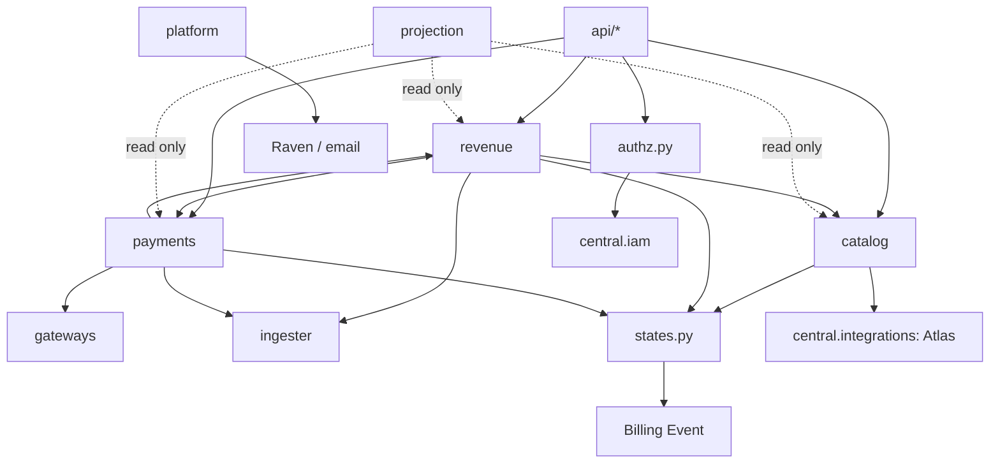

# Dependency map

Snapshot `a95b491e`.

## Internal dependencies

`revenue` and `payments` import each other (invoicing calls collection; settlement
writes invoice state). It works, but there is no single owner of "invoice paid".

## External dependencies

| Dependency | Used for | Client | Timeout | Evidence |
|---|---|---|---|---|
| Stripe | Cards, India card mandates, top-ups, refunds, disputes | `stripe` Python SDK, API version pinned per request | SDK default (80 s); `stripe.max_network_retries = 2` set at module level | `gateways/stripe_adapter.py:32,180-187` |
| Razorpay | UPI Autopay, RuPay, netbanking, INR top-ups, recurring debits | `razorpay` Python SDK | **None set.** The SDK uses `requests` with no timeout by default. | `gateways/razorpay_adapter.py:65` |
| PayPal | International top-ups, vaulted charges | Plain `requests` | 30 s on every call | `gateways/paypal_adapter.py:301-449` |
| ERPNext | Customers, Sales Invoices, Payment Entries, advances, credit notes, GST status | `requests` | 30 s (`TIMEOUT_SECONDS`) | `ingester/connection.py:48-119` |
| Atlas | VM lifecycle, region capacity, stop/start for pause and suspension | `central.integrations` | outside billing scope | `catalog/subscriptions.py:1145` (`_control_subscription_server`) |
| Grove, Cargo | Metered usage totals | Inbound `report_usage` (pilot credential) | n/a | `api/billing_api.py:623` |
| Raven | Operator alerts | `requests` | `RAVEN_TIMEOUT_SECONDS` | `platform/alerts.py:354` |
| Frappe email | Customer notices, operator email alerts | Frappe queue | n/a | `platform/notifications.py` |

## Python packages billing relies on

`stripe`, `razorpay`, `requests`, `frappe`, `cryptography` (only for the retired
entitlement signing, `catalog/signing.py`).
