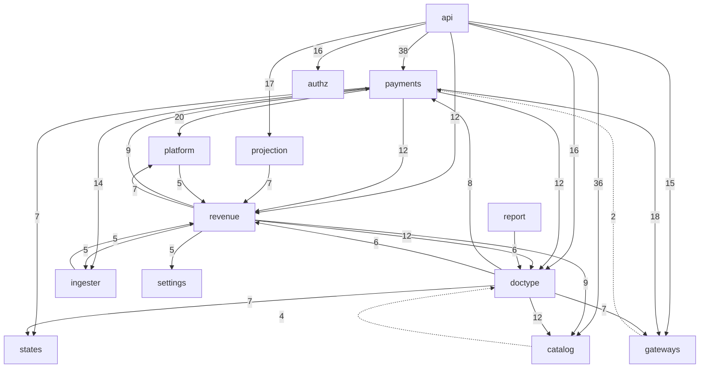

# Dependency map

Snapshot central `a95b491e` (9 Nov 2026). Internal edges come from parsing every
`import` / `from … import` statement in `central/billing/**/*.py`, excluding `tests/`
and `demo/` (AST, read-only). A count is the number of import statements, not the
number of calls. Imports inside functions are included. Evidence level E1: an import
proves a dependency exists in code, not how it is used.

## Sub-packages

`api`, `catalog`, `doctype`, `gateways`, `ingester`, `payments`, `platform`,
`projection`, `report`, `revenue`, plus top-level modules `authz.py`, `states.py`,
`settings.py`, `india_gst.py`, `regions.py`, `navigation.py`.

## Initial module dependency diagram

Edges with 5 or more import statements, plus the two short edges that close a cycle.

## All internal edges

| From → To | Imports | | From → To | Imports |
|---|---|---|---|---|
| api → payments | 38 | | doctype → platform | 3 |
| api → catalog | 36 | | doctype → ingester | 3 |
| payments → platform | 20 | | projection → doctype | 3 |
| payments → gateways | 18 | | payments → api | 2 |
| api → projection | 17 | | payments → india_gst | 2 |
| api → doctype | 16 | | ingester → india_gst | 2 |
| api → authz | 16 | | catalog → states | 2 |
| api → gateways | 15 | | platform → doctype | 2 |
| payments → ingester | 14 | | platform → ingester | 2 |
| payments → doctype | 12 | | gateways → payments | 2 |
| payments → revenue | 12 | | api → india_gst | 2 |
| api → revenue | 12 | | api → report | 2 |
| revenue → doctype | 12 | | report → settings | 2 |
| doctype → catalog | 12 | | report → regions | 2 |
| revenue → payments | 9 | | report → projection | 2 |
| revenue → catalog | 9 | | report → platform | 2 |
| doctype → payments | 8 | | doctype → settings | 2 |
| payments → states | 7 | | projection → settings | 2 |
| revenue → platform | 7 | | states → doctype | 1 |
| doctype → gateways | 7 | | ingester → platform | 1 |
| doctype → states | 7 | | ingester → payments | 1 |
| projection → revenue | 7 | | ingester → states | 1 |
| report → doctype | 6 | | catalog → platform | 1 |
| doctype → revenue | 6 | | platform → payments | 1 |
| ingester → revenue | 5 | | platform → india_gst | 1 |
| platform → revenue | 5 | | api → platform | 1 |
| revenue → settings | 5 | | report → revenue | 1 |
| revenue → ingester | 5 | | revenue → india_gst | 1 |
| payments → catalog | 4 | | doctype → india_gst | 1 |
| catalog → doctype | 4 | | api → regions | 3 |
| api → ingester | 4 | | report → catalog | 3 |
| revenue → states | 4 | | platform → settings | 3 |
| projection → payments | 4 | | platform → catalog | 3 |
| projection → catalog | 4 | | payments → settings | 3 |
| ingester → doctype | 3 | | catalog → revenue | 3 |

## Observations

| # | Observation | Level | Evidence |
|---|---|---|---|
| D-1 | Two-way dependencies: `revenue` ↔ `payments` (12 / 9), `doctype` ↔ `catalog` (12 / 4), `doctype` ↔ `payments` (8 / 12), `doctype` ↔ `revenue` (6 / 12), `payments` ↔ `gateways` (18 / 2), `revenue` ↔ `ingester` (5 / 5), `platform` ↔ `revenue` (5 / 7), `catalog` ↔ `revenue` (3 / 9). | E1 | table above |
| D-2 | Domain code imports the customer API layer: `payments/instruments.py:146` imports `_enabled_gateway_for_currency`, `payments/provisioning.py:45` imports `currency_for_country`, both from `api/dashboard/_shared.py`. | E2 | those lines |
| D-3 | Gateway adapters import from `payments`: `gateways/base.py:17` (`payments.decline.Failure`), `gateways/razorpay_recurring.py:7` (`payments.decline.REQUEST_REFUSED`). | E2 | those lines |
| D-4 | `states.py` is imported by `payments`, `doctype`, `revenue`, `catalog`, `ingester`; it imports `doctype` once (`billing_event`, `states.py:15`). | E1 | table |
| D-5 | Inside billing, only `api` and `report` import `projection`. | E1 | table |
| D-6 | Only `api` imports `report` (2 imports). | E1 | table |

## Dependencies on the rest of Central (outbound)

| Billing module → Central package | Imports |
|---|---|
| api → `central.signups` | 7 |
| catalog → `central.infrastructure`, `central.server_models`, `central.resource_actions`, `central.signups` | 2 each |
| api → `central.infrastructure` | 2 |
| api → `central.api`, `central.iam` | 1 each |
| catalog → `central.api` | 1 |
| payments → `central.notification` | 1 |
| platform → `central.notification`, `central.signups`, `central.services` | 1 each |
| revenue → `central.services` | 1 |
| doctype → `central.iam` | 1 |
| authz → `central.iam` | 1 |

## Dependencies on billing from the rest of Central (inbound)

| Central package → billing module | Imports | Files |
|---|---|---|
| `signups` → catalog (7), platform, settings, payments, revenue, doctype | 12 | `central/signups/alerts.py`, `credit.py`, `eligibility.py`, `trial.py` |
| `integrations` → catalog | 6 | `central/integrations/images.py`, `pilot.py`, `resource_actions.py` |
| `infrastructure` → catalog (6), settings (2) | 8 | `central/infrastructure/doctype/resource_action/resource_action.py`, `virtual_machine/virtual_machine.py`, `vm_snapshot/vm_snapshot.py` |
| `resource_actions.py` → catalog (5), revenue (2), doctype, payments | 9 | `central/resource_actions.py` |
| `api` → catalog (4), doctype, settings | 6 | `central/api/servers.py`, `central/api/snapshots.py` |
| `identity` → payments (2), settings, doctype | 4 | `central/identity/doctype/team/team.py`, `archive.py` |
| `services` → catalog | 2 | `central/services/ai.py`, `doctype/team_service/team_service.py` |
| `site_provisioning.py`, `server_models.py` → catalog | 3 | those files |
| `patches` → settings, doctype, payments, revenue, gateways, india_gst, api | 19 | 9 files in `central/patches/v0_0/` |

Billing is not a leaf: server creation, VM lifecycle, snapshots, trials, team archive
and AI services import billing modules, most often `catalog`. What they call was not
traced in this phase.

## External packages

| Package | Imported in (non-test) | Evidence |
|---|---|---|
| `stripe` | `gateways/stripe_adapter.py` | 19 call sites, see [outbound-call-sites.md](outbound-call-sites.md) |
| `razorpay` | `gateways/razorpay_adapter.py`, `razorpay_recurring.py` | client built at `razorpay_adapter.py:65` |
| `requests` | `gateways/paypal_adapter.py`, `ingester/connection.py`, `platform/alerts.py`; `gateways/razorpay_adapter.py:28` for exception types | call sites file |
| `cryptography` | `catalog/signing.py:14-16` | Ed25519 key handling |
| `frappe` | everywhere | — |
