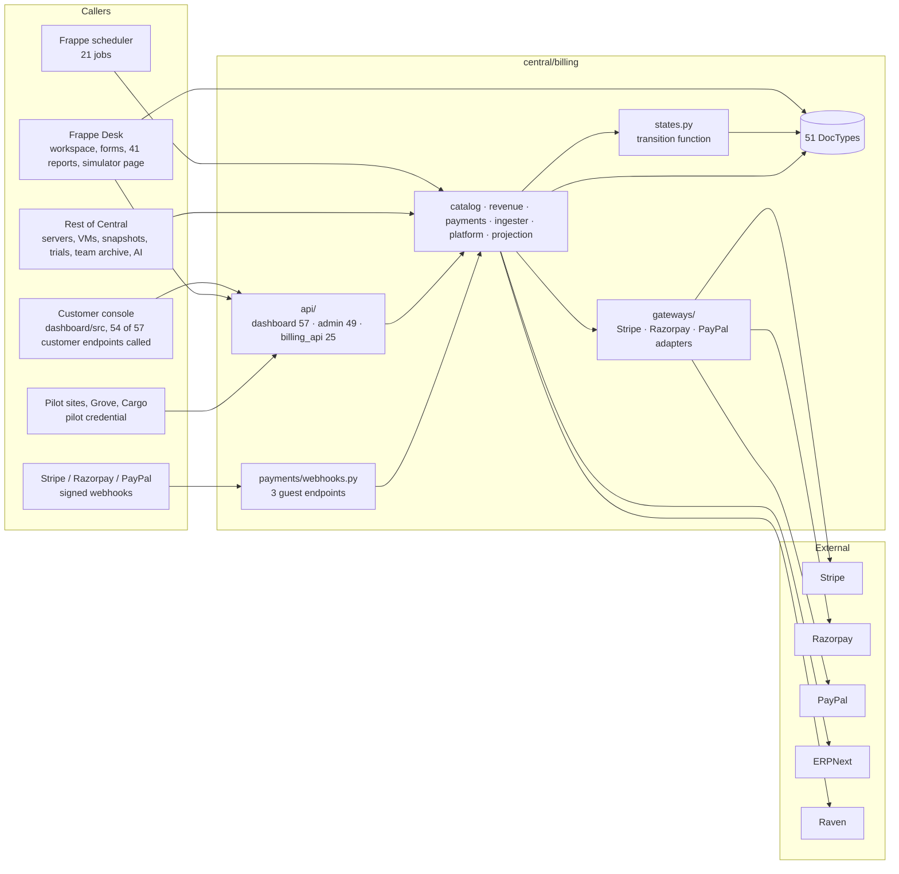
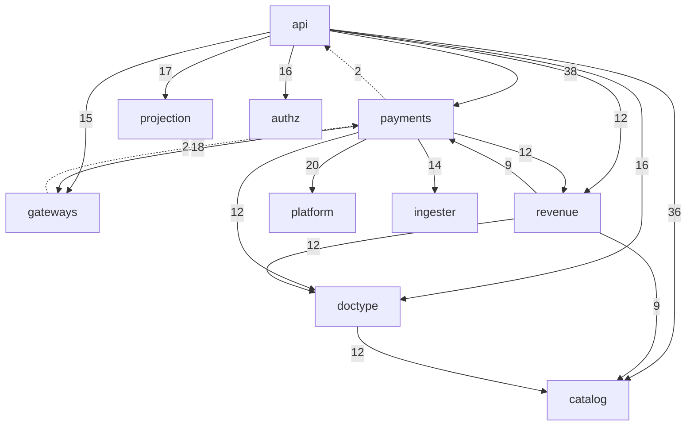

# Phase 1 summary

Snapshot central `a95b491e` (9 Nov 2026). Evidence reached: E1–E2. Nothing was run
against a database, a gateway or production. Phase 1 stops here for review.

## System architecture overview

Facts behind each arrow: callers from [api-inventory.md](api-inventory.md) and
[jobs-and-hooks.md](jobs-and-hooks.md); "Rest of Central → domain" from the inbound
import scan in [dependency-map.md](dependency-map.md); outbound arrows from
[outbound-call-sites.md](outbound-call-sites.md). Desk → DocTypes is limited to
operators by permission hooks on 21 DocTypes (`central/hooks.py:440-501`,
`central/permissions.py:355-365`).

## Initial module dependency diagram

Import statements between billing sub-packages (≥ 9 shown). Full table in
[dependency-map.md](dependency-map.md).

Dashed: imports against the expected direction (domain → API layer; adapter → domain).

## What Phase 1 found

| # | Finding | Level | Source |
|---|---|---|---|
| P1-01 | Billing is a module of the `central` app, not a separate app. Its customer UI is part of `dashboard/`. | E1 | directory layout; `dashboard/src/router/index.ts:114-130` |
| P1-02 | 145 whitelisted functions: 57 customer, 49 operator, 25 pilot facade (guest), 3 webhooks (guest), 11 Desk form methods. 71 accept any HTTP method. | E1 | [api-inventory.md](api-inventory.md) |
| P1-03 | Every guest endpoint is behind `pilot_credential_auth` (25) or a webhook signature check (3). | E1 (decorator / call present) | api-inventory |
| P1-04 | Every `api/admin` endpoint calls `require_operator`. Every `api/dashboard` endpoint calls a capability helper except `get_billing_geo` (reference data only). | E1, E2 for the exceptions | api-inventory |
| P1-05 | Non-operators get no billing records through Frappe's generic reads: operator-only permission hooks on the same 21 DocTypes that link to `Team`. | E2 | `central/hooks.py:440-501`; `central/permissions.py:355-365` |
| P1-06 | 21 scheduled jobs; 22 `enqueue` sites; install/migrate/test hooks seed catalog, gateways, settings and one CHECK constraint (`Credit Wallet.balance >= 0`). | E1 | [jobs-and-hooks.md](jobs-and-hooks.md) |
| P1-07 | Two-way imports between `revenue` ↔ `payments`, `doctype` ↔ `catalog`, `doctype` ↔ `payments`, `payments` ↔ `gateways` and others. Domain code imports the API layer in 2 places. | E1 / E2 | [dependency-map.md](dependency-map.md) D-1 to D-3 |
| P1-08 | Billing is imported by 9 other Central areas (servers API, VM and snapshot DocTypes, resource actions, signups, identity, services, integrations, patches). | E1 | dependency-map inbound table |
| P1-09 | Outbound HTTP: PayPal, ERPNext and Raven calls set a timeout; no Stripe or Razorpay call site passes `timeout=`, and the Razorpay client is built without one. | E1 (call sites); E2 (`razorpay_adapter.py:65`) | [outbound-call-sites.md](outbound-call-sites.md) |
| P1-10 | 51 DocTypes; unique fields on Invoice (`period_key`), Payment Attempt (`idempotency_key`), Webhook Event (`gateway_event_id`), Usage Rollup (`idempotency_key`), Credit Ledger Entry (`gateway_payment_id`, `instrument_fingerprint`) and others. | E1 (JSON) | [data-model-map.md](data-model-map.md) |
| P1-11 | 3 customer endpoints have no caller in the console or Desk: `whoami`, `provision_composed_config`, `get_fallback_offer`. | E1 | api-inventory |
| P1-12 | `Entitlement Token` DocType and `catalog/entitlements.py:193` `issue_token` remain; no caller of `issue_token` outside tests and demo. | E1 | search |
| P1-13 | 119 server test modules (1,765 test functions), 15 Playwright billing specs (26 tests); CI runs `run-tests --app central` with `allow_tests` set. Test results not checked. | E1 | [docs-and-tests.md](docs-and-tests.md) |
| P1-14 | `AGENTS.md:57` declares `central/billing/**` out of scope for the ongoing rewrite. | E2 | `AGENTS.md` |

## Corrections to the earlier pass

The earlier (pre-rules) teardown on this branch contains a statement that Phase 1
disproves. Not edited here, as asked; flagged for the review:

| Earlier statement | Where | What Phase 1 found |
|---|---|---|
| "No row-level permission hooks on team-scoped billing DocTypes" (F-30, S-01, RK-10, O-section, roadmap C16) | `09-security/security-review.md`, `10-final-assessment/*` | Hooks exist since `fcf94a83` (29 Oct 2026): `central/hooks.py:481,501` register operator-only `billing_record_query_conditions` and `billing_record_has_permission` for 21 DocTypes. The earlier search looked for DocType names inside the hook dicts and missed the `**dict.fromkeys(_BILLING_TEAM_RECORDS, …)` form. |
| "52 DocTypes (36 documents, 15 child tables, 1 single)" | `02-domain-model/data-dictionary.md` | 51 DocTypes: 33 documents, 17 child tables, 1 single |
| "Customer console API: 60; operator API: 47" (since corrected to 57 / 49) | earlier `01-discovery` files | 57 / 49 (now replaced) |

## Unknowns

| # | Unknown | Why it matters | How to resolve |
|---|---|---|---|
| U-01 | Whether DocType `unique: 1` fields have unique indexes in the production database | Duplicate protection depends on it | `SHOW INDEX` per table on production (read-only) |
| U-02 | Whether the 21 scheduled jobs run on schedule, and how long they take | Every money flow after checkout depends on them | Scheduler / RQ job history |
| U-03 | Which queues production declares (`billing`, projection) | `billing_queue()` falls back to `long` with only a log warning (`run.py:65-79`) | `common_site_config.json` workers |
| U-04 | What `pilot_credential_auth` checks | 25 guest endpoints rely on it | Read its implementation (Phase 2 or 9) |
| U-05 | Whether any of the 71 any-method endpoints writes through a called function | Writes during GET are rolled back by Frappe | Trace callees |
| U-06 | Which permission Frappe checks for the 11 Desk form methods | Operator-only by DocType permission, exact ptype unknown | Read Frappe's `run_doc_method` path |
| U-07 | Whether the installed Stripe and Razorpay SDKs set default request timeouts | P1-09 | Read installed packages |
| U-08 | What the 9 other Central areas call in billing | Billing changes can break server creation, trials, team archive | Trace the inbound imports |
| U-09 | Whether the 3 uncalled customer endpoints are used outside this repo | Dead code or a hidden caller | Check pilot sites and other repos |
| U-10 | Test suite state on `a95b491e` | Tests as evidence (E3) need a green run | CI history for the commit |
| U-11 | Accuracy of `ARCHITECTURE.md` beyond the lines cited | Used as a map | Check each flow in Phase 3 |
| U-12 | How Atlas stop/start and resource actions behave | Pause, suspension and provisioning depend on them | Outside billing; trace in Phase 5 |

## Recommended Phase 2 investigation targets

Phase 2 is the domain and data model. In order:

1. **Source of truth per money fact.** For Invoice, Payment Attempt, Refund, Credit
   Ledger Entry / Credit Wallet, Top-up Order: trace every write site (`insert`,
   `save`, `db_set`, `set_value`) and confirm each goes through `states.transition`
   or `platform.records.save_billing_record`.
2. **Unique and check constraints in the database** (U-01) next to the DocType JSON.
3. **Team-level state stored per row**: `Subscription.account_standing` and its readers;
   `Billing Profile.trust_tier` vs `trust_tier_level`; `Subscription.default_payment_method`
   / `gateway` vs `Payment Method.priority`.
4. **Central ↔ ERPNext field mapping**: which Invoice fields are copied to the Sales
   Invoice, which are recomputed by ERPNext (`ingester/erpnext_sync.py:158-196`,
   `ingester/gst.py`).
5. **Type consistency**: `currency` as Data on Invoice, Payment Attempt, Usage Rollup;
   `reference_type/name` on Credit Ledger Entry as Data.
6. **Retired entities**: Entitlement Token, `catalog/signing.py`; confirm no reader.
7. **Inbound callers** (U-08): what `central/resource_actions.py`, `central/api/servers.py`,
   `central/signups/*` and the VM / snapshot DocTypes read or write in billing.
8. **Lifecycles**: compare the state machines in `states.py:39-158` with every place a
   status field is written.
