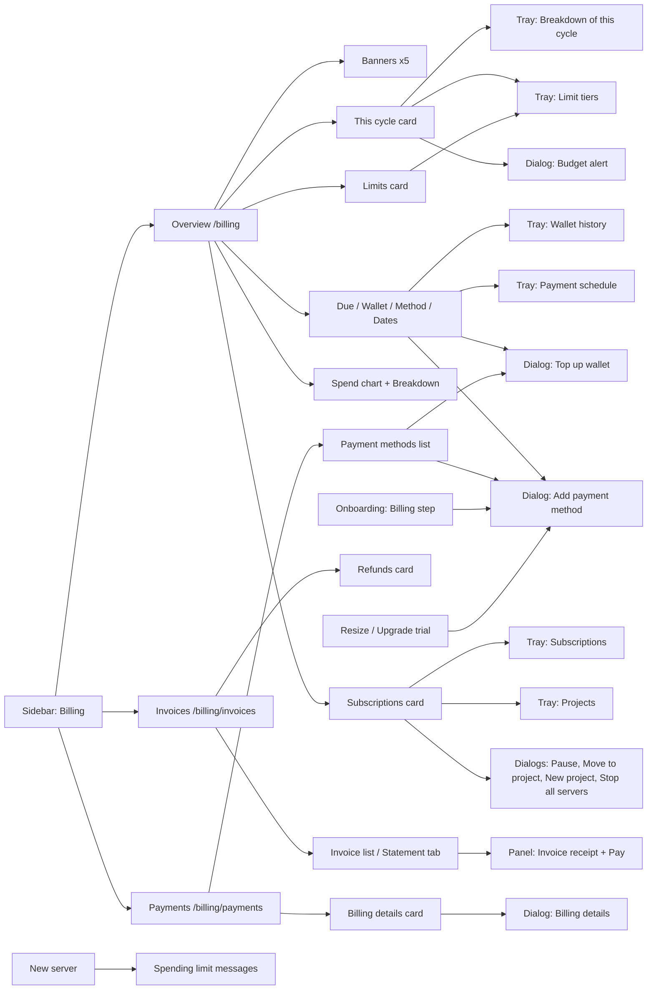

# Billing screen map

Every place a customer meets billing in the console, what opens it, and which API
feeds it. Routes are from `dashboard/src/router/index.ts:114-130`. Sidebar entries
are from `dashboard/src/components/navigation/list.ts:93-116`.

## Pages

| Page | File | Components on load | API calls on first load |
|---|---|---|---|
| Overview | `pages/billing/BillingOverviewPage.vue` | 5 banners, 5 cards, 6 trays, 3 dialogs | 19 (see below) |
| Invoices | `pages/billing/BillingInvoicesPage.vue` | List or Statement, Refunds, receipt panel | 4: invoices, statement, refunds, collection status |
| Payments | `pages/billing/BillingPaymentsPage.vue` | Setup alert, Payment methods, Billing details | 4: methods, credit balance, collection status, profile |

### Overview API calls

Counted from the composables the page mounts. Several are shared singletons, so a
second card that uses one does not call it again.

| Source | Calls |
|---|---|
| `useBillingOverview.ts:26-81` | team overview, forecast, credit balance, credit ledger, payment methods, billing profile, subscriptions, projects, next payment, cycle costs (10) |
| `useBillingReports.ts:30-48` | spend history, statement, tax summary, payment attempts (4) |
| `useSpendingLimits.ts:25` | trust tier (1) |
| `usePayingFor.ts:17` | metered services (1) |
| `useServerMapData.ts:51` | server registry (1), for the trial Upgrade dialog |
| `EstimatedCard.vue:67` | billing settings (1), for the budget alert |
| `CollectionActionBanner.vue:19` | collection status (1) |

## Trays and dialogs

| Surface | File | Opened from |
|---|---|---|
| Breakdown of this cycle | `components/billing/CycleBreakdownPanel.vue` | "See breakdown" on the This cycle card |
| Wallet history | `components/billing/WalletHistoryPanel.vue` | "Wallet history" icon in the facts card |
| Payment schedule | `components/billing/PaymentSchedulePanel.vue` | Calendar icon next to Next payment date |
| Subscriptions | `components/billing/PayingForPanel.vue` | "View all" when there are more than 5 rows |
| Projects | `components/billing/ProjectsPanel.vue` | "View all" in the Projects row |
| Limit tiers | `components/billing/TiersPanel.vue` | Tier name on the This cycle card, "Tiers" on the Limits card |
| Budget alert | inline in `EstimatedCard.vue:279-312` | "Budget alerts" button |
| Top up wallet | `components/TopupDialog.vue` | "Add credit", "Top up", Wallet history footer |
| Add payment method | `components/AddMethodDialog.vue` | "Add card", "Add another card", Limits card, onboarding |
| How do you want to pay? | inline in `CollectionActionBanner.vue:99-148` | INR Action Required banner only |
| Billing details | `components/billing/EditBillingProfileDialog.vue` | Setup banner, GST banner, Billing details "Edit" |

## Components with no screen

| Component | Evidence | Note |
|---|---|---|
| `components/billing/MeteredServicesCard.vue` (172 lines) | No import anywhere in `dashboard/src` | Its content moved into the Subscriptions table. Dead code. |
