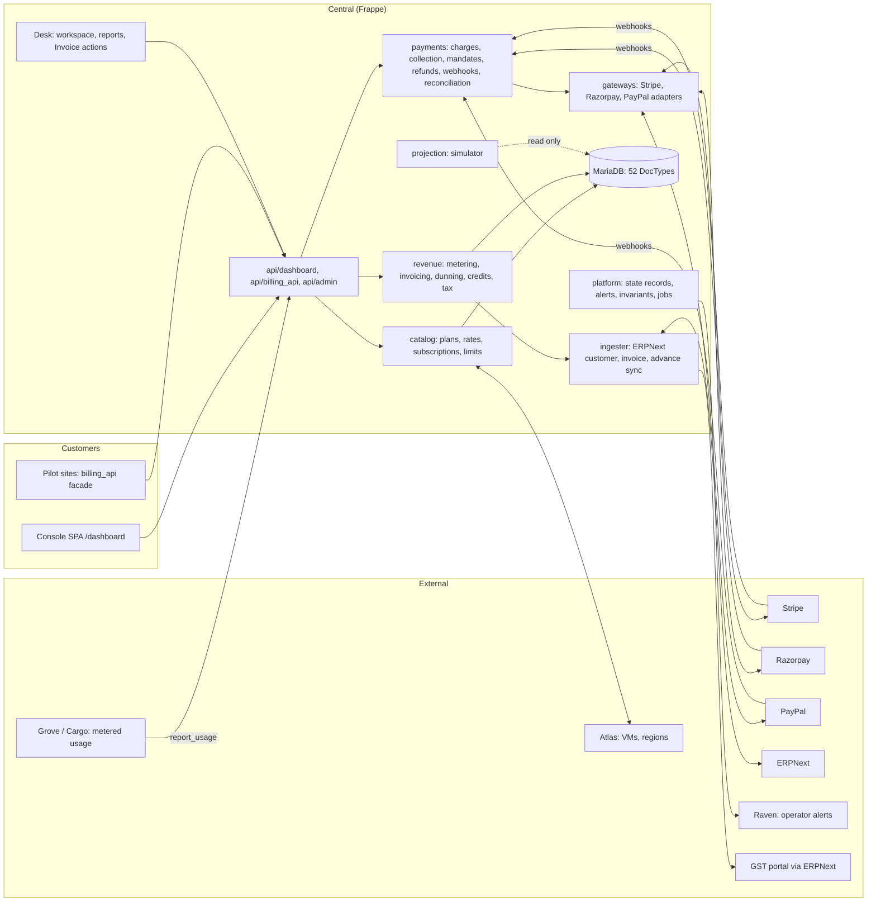

# System overview

Snapshot: central `upstream/develop` at `a95b491e` (9 Nov 2026). Paths start at the
central repo root.

## What Central Billing is

Billing is a module inside the `central` Frappe app (`central/billing/`), not a
separate app. It prices servers and metered services, records what ran, issues a
monthly invoice per team, collects it from a wallet and a saved payment method, and
pushes the paid share to ERPNext, which issues the legal tax invoice (ADR 0019).

| Fact | Value | Evidence |
|---|---|---|
| Framework | Frappe 17 (dev), Python, MariaDB | `central/hooks.py` |
| Customer UI | Vue 3 + frappe-ui SPA at `/dashboard` | `dashboard/vite.config.ts`, `dashboard/src/router/index.ts` |
| Operator UI | Frappe Desk: Billing workspace, DocType forms, 41 reports, 1 Desk page | `central/billing/workspace/billing/billing.json`, `central/billing/report/`, `central/billing/page/billing_simulator` |
| Backend size (excl. tests, demo) | ~38,700 lines of Python | line counts per sub-package, see [module-inventory.md](module-inventory.md) |
| Tests | 119 test modules, ~30,800 lines | `central/billing/tests/` |
| DocTypes | 52 (36 documents, 15 child tables, 1 single) | `central/billing/doctype/` |
| Whitelisted endpoints | 145 (28 guest, all behind a pilot credential or a webhook signature) | `@frappe.whitelist` count |
| Scheduled jobs | 13 daily, 6 hourly, 2 monthly | `central/hooks.py`, `scheduler_events` |

## High-level architecture

## Entry points

| Kind | Where | Count |
|---|---|---|
| Customer console API | `central/billing/api/dashboard/*.py` | 57 |
| Pilot / site facade | `central/billing/api/billing_api.py` | 25 guest, each behind `pilot_credential_auth` |
| Operator API | `central/billing/api/admin/*.py` | 49 |
| Gateway webhooks | `central/billing/payments/webhooks.py:29-49` | 3 guest (Stripe, Razorpay, PayPal), signature checked first (`:80`) |
| DocType form methods | `doctype/payment_gateway`, `doctype/plan_configurator` | 10 |
| Scheduler | `central/hooks.py` `scheduler_events` | 21 billing jobs |
| Doc events | `central/hooks.py:215-230` | `refuse_manual_edit` / `refuse_manual_delete` on 9 money DocTypes |

## Configuration

| Where | What |
|---|---|
| `Billing Settings` (single, 78 fields) | Dunning days, suspension day, payment day limits, retention, alert channel, welcome credit, minimum invoice, GST rate, routing |
| `Payment Gateway` (one row per adapter) | Credentials, currencies, webhook secret, routing defaults |
| `Trust Tier Level` + `Trust Tier Threshold` | Spending limit ladder per currency |
| `Plan`, `Plan Category`, `Plan Sub-Category`, `Resource Type`, `Catalog Rate`, `Plan Configurator` | Catalog and prices |
| Site config | Gateway keys (read through `get_credential`), ERPNext URL and keys, pilot credentials, entitlement signing key |

## Documentation found

| Document | Notes |
|---|---|
| `central/billing/ARCHITECTURE.md` (748 lines) | Sub-module map, DocType graph, triggers, flows, symptom cheat-sheet. Used as a map; claims checked against code where cited. |
| `central/billing/docs/reports.md`, `metered-services-api.md` | Report catalogue, metering API |
| This repository (`billing-specs`) | Design docs, ADRs 0001–0025, issues 01–145 |
