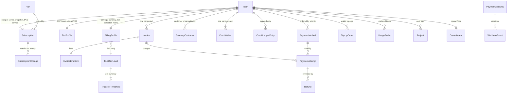

# Domain model

Snapshot `a95b491e`. Field lists come from the DocType JSON in
`central/billing/doctype/`. "Creation" and "Update" name the function that writes
the record. Status changes go through `states.transition()` (`central/billing/states.py`),
which also appends a `Billing Event`.

## Entity graph

## Entities by concern

The source prompt asked for customers, billing accounts, products, plans, pricing,
subscriptions, orders, usage, invoices, invoice items, credit notes, payments,
refunds, credits, taxes and accounting entries. This table maps each to what Central
actually has.

| Concept | Central entity | Purpose | Created by | Updated by | States | Source of truth |
|---|---|---|---|---|---|---|
| Customer | `Team` (identity module) | The billed party | Signup | Identity code | — | Central |
| Billing account | `Billing Profile` (named by team) | Currency, address, GSTIN, collection mode, payment day, tier, spend alert | `save_billing_profile` (`api/dashboard/account.py`) | Same; dunning; tier promotion | `collection_mode`: Auto Charge / Manual Checkout / Prepaid / Action Required | Central. Currency locks after activity (`billing_profile.py:304,433`) |
| Product | `Plan Category`, `Plan Sub-Category`, `Resource Type` | Product families and what they bill | Catalog setup, `Plan Configurator` | Desk | — | Central |
| Plan | `Plan` + `Plan Includes` | A sellable bundle of resources | `Plan Configurator.generate` | Desk | `enabled` | Central |
| Pricing | `Catalog Rate` | Rate per (plan or resource type, currency, region) | `Plan Configurator.publish_rates`, `api/admin/catalog.py:84,126` | Same | — | Central. Customer's price is then locked on the change row. |
| Subscription | `Subscription` | One billable thing a team runs | `catalog/subscriptions.py` (create on provision, `:120,:328`), `snapshots.py:33`, `public_ips.py:53` | Pause/resume (`:1134-1159`), standing (`:1162+`), resize | `enabled`; `account_standing`: Current / Past Due / Suspended | Central |
| Price lock / order history | `Subscription Change` (append-only) | Each change with the `locked_rate` it bills at (ADR 0010) | `_record_change` in `catalog/subscriptions.py` | Never (`subscription_change.py:45`) | `change_type`: Created, Plan Changed, Payment Method Changed, Paused, Resumed, Past Due, Suspended, Reactivated, Cancelled | Central. This row *is* the rate lock. |
| Order | No separate order entity. A provision request is a Resource Action (outside billing) that ends in a Subscription. `Top-up Order` is the only "order". | | | | | |
| Usage record | `Usage Rollup` | Running total per (resource, period), versioned by `superseded_by` | `revenue/metering.py` `ingest_rollup` (`:193`), `report_usage` API | A new row supersedes the old; totals can only rise (`metering.py:287`) | — | The reporting service (Grove, Cargo) for raw usage; Central for the billed total |
| Invoice | `Invoice` | One per team per period (`period_key` unique) | `revenue/invoicing/generate.py`, monthly `draft_monthly_invoices` | `lifecycle.py` (open, settle, cancel), dunning | Outstanding / Paid / Overdue / Waived / Cancelled; plus `hold_reason` | **Split.** Central for amount charged; ERPNext Sales Invoice for the legal tax invoice (ADR 0019). See [entity-ownership.md](entity-ownership.md). |
| Invoice item | `Invoice Line Item` (child) | One line per segment or metered meter, with `basis` and project tag | Generator only | Never after generation | — | Central |
| Credit note | No Central entity. `Invoice.credit_note_id` points to the ERPNext credit note. | | `payments/corrections.py` | | | ERPNext |
| Payment | `Payment Attempt` | One charge try against an invoice | `charges.py` (`_claim_on_session_attempt`, off-session charge), collection | Webhook, reconciliation | Initiated / Authorised / Captured / Failed / Refunded | Gateway; Central mirrors it on webhook |
| Refund | `Refund` | Money back to source or wallet | `payments/corrections.py`, `refunds.py` | Webhook, `recheck_completed_refunds` | Initiated / Pending / Completed / Failed | Gateway for source refunds; Central ledger for wallet refunds |
| Credit | `Credit Ledger Entry` (append-only) + `Credit Wallet` (balance cache and lock row) | Wallet money: top-ups, promo, refunds, draws | `revenue/credits.py` | Ledger never; wallet only by booking an entry (`credit_wallet.py:40`) | `entry_type`: Credit / Debit; promo `expires_on` | Ledger. Wallet balance and `running_balance` are derived. |
| Tax | `Tax Profile` + invoice tax fields | GST additive, SEZ/Overseas zero-rating, TDS withholding | `revenue/tax.py` `resolve_tax` at generation | Profile by operator | — | Central computes; ERPNext recomputes from its template (see [../04-financial-integrity/calculation-risks.md](../04-financial-integrity/calculation-risks.md)) |
| Accounting entry | No Central GL. Sales Invoice, Payment Entry, advance and credit note live in ERPNext. | | `ingester/erpnext_sync.py`, `advance.py` | Retries (`retry_failed_syncs`) | `Invoice.erpnext_sync_status`: Pending / Synced / Failed / Not Required | ERPNext |

## Supporting entities

| Entity | Purpose |
|---|---|
| `Trust Tier Level`, `Trust Tier Threshold` | Spending limit ladder per currency; the team's rung is on Billing Profile |
| `Payment Gateway`, `Payment Gateway Currency`, `Gateway Customer` | Gateway config, routing per currency, customer id per gateway |
| `Webhook Event` | Every inbound gateway event, unique on `gateway_event_id` |
| `Billing Event` | Derived, immutable audit stream of transitions; no billing code may read it to decide (`states.py:1-11`) |
| `Billing Run`, `Billing Run Team` | The monthly run and one row per team it covered |
| `Commitment` | Team spend floor with discount and clawback |
| `Project` | Cost tag with optional run-rate limit; never changes who is billed |
| `Billing Notification Log` | Customer notices sent or suppressed |
| `Rerating Run` | Operator re-price of a past period |
| `Billing Scenario`, `Billing Projection Batch/Summary` | Simulator inputs and outputs |
| `Billing Settings` (single) | Policy knobs |
| `Entitlement Token` | Retired by ADR 0006; still present (see module inventory) |

## Lifecycles

See [../03-workflows/lifecycle-diagrams.md](../03-workflows/lifecycle-diagrams.md) for
the state diagrams of Invoice, Payment Attempt, Subscription standing, Refund,
Payment Method, Top-up Order and Webhook Event, taken from `states.py:39-158`.
