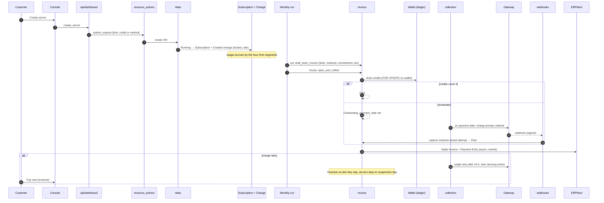
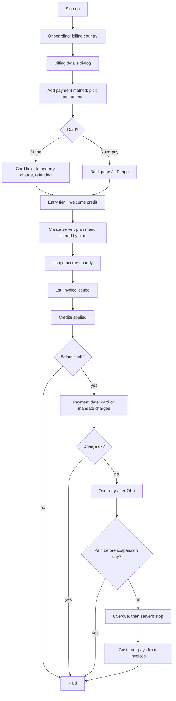

# Customer to cash

Two views of the same path at `a95b491e`: first the system (what runs, in what order,
who owns each step), then seven customer tasks walked click by click through the
console code.

## System view

| Step | Owner | Failure handling |
|---|---|---|
| Purchase gate | `central.resource_actions.validate_purchase` | Refuses with a limit or setup message (see [error audit](../07-resilience/error-message-audit.md)) |
| Segment and rate lock | `Subscription Change` | Append-only; `backfill_missing_subscriptions` daily repairs a VM with no subscription |
| Draft | `revenue/invoicing/run.py` | Per-team savepoint; failed team kept as Billing Run Team Failed, retried hourly |
| Open and credit draw | `revenue/invoicing/lifecycle.py` | Held if billing details missing (`hold_reason`) |
| Charge | `payments/collection.py` | Escalate to next method; single retry; dunning |
| Confirm | `payments/webhooks.py` | Stored once, retried hourly; reconciliation asks the gateway |
| Accounting | `ingester/erpnext_sync.py` | Backoff retries; never rolls back the invoice |

## Customer view

Seven tasks a customer does, walked click by click through the code. Each ends with
the number of decisions the customer makes and where the path breaks.

## J1. Set up billing for the first time

1. Onboarding billing step: pick country (`BillingCountryField.vue`). Currency is
   set from it.
2. Press "Add payment method" (`BillingStep.vue:63-74`). If details are missing,
   the details dialog opens first (`PaymentMethodFlow.vue:14-21`).
3. Fill legal name, address, city, (GSTIN for India). Save.
4. Add method dialog opens by itself. Pick a tile, then card field or bank page.
5. Card: press "Add card". Only now does the customer learn of the temporary charge
   (`AddMethodDialog.vue:263-268`).

**Decisions:** 4. **Breaks:** the "No charge today" promise (F-04). Otherwise smooth:
the details-then-method chain is automatic.

## J2. Understand this month's bill

1. Overview: headline amount with tax (`EstimatedCard.vue:196`).
2. "See breakdown" opens the tray with lines by server and estimated lines marked.
3. Back on the page, the Subscriptions header shows a second, lower figure "this
   cycle before tax", from a different endpoint (`PayingForCard.vue:67-70`).
4. The Limits card shows a third figure as "Spend per cycle" (`LimitsCard.vue:78-85`).

**Decisions:** 1. **Breaks:** three different numbers for "this month" on one page
with no label that explains the difference (F-01, F-08).

## J3. Pay an overdue invoice

1. Overview banner "₹X overdue on your October invoice" → "Pay now".
2. Lands on Invoices, **with no invoice selected** (`OutstandingAlert.vue:90-92`
   pushes `BillingInvoices` without `?invoice=`). The page supports `?invoice=`
   (`BillingInvoicesPage.vue:73-80`), the banner does not use it.
3. Customer finds the overdue row, opens it, presses "Pay ₹X now".
4. Auto Charge: off-session charge, toast "Payment initiated…". Manual Checkout:
   Razorpay sheet.

**Decisions:** 3, one of them a search the banner could have skipped. **Breaks:**
the banner's "Pay now" does not open the invoice it talks about (F-20). Manual
Checkout on a non-Razorpay currency (F-10).

## J4. Add credit to the wallet

1. "Add credit" on the facts card, or "Top up" on Payments.
2. Type an amount or press a quick amount, pick instrument, "Continue to payment".
3. Card field or gateway sheet.

**Decisions:** 3. **Breaks:** quick amounts are INR-sized for every currency (F-07).

## J5. Change which card pays first

1. Payments › method row menu.
2. If the wallet has any balance, "Primary payment method" is disabled; "Move up"
   works (F-06).
3. If the team is Prepaid, making a card primary also turns on Auto Charge without
   saying so (F-05).

**Decisions:** 1–2. **Breaks:** disabled option with no reason shown; hidden mode change.

## J6. Stop spending

Three paths, each with different words:

| Path | Where | Label | Effect |
|---|---|---|---|
| A | Overview › Subscriptions row menu | "Pause billing" | Disables subscription, stops server (`catalog/subscriptions.py:1134-1146`) |
| B | Overview › Subscriptions card | "Stop all servers" (type the team name) | Stops every running server (`StopAllServersRow.vue:37-62`) |
| C | Servers › server menu | Stop | Stops the server |

All three end billing for compute, since a stopped server is not billed
(`projection/state.py:160`). The customer cannot tell from the labels that they are
the same. Path A reports success even when the call fails (F-03, F-11).

## J7. Change how you pay (auto charge, manual, prepaid)

1. INR team over ₹15,000: banner "Action required: choose how to keep paying",
   pick "Pay each invoice" or "Prepaid wallet".
2. To go back to Auto Charge: no control. The banner said "You can switch anytime
   in Billing settings" (`CollectionActionBanner.vue:135`); there is no such screen.
   The only way back is to make a card primary on Payments, which flips the mode as
   a side effect.
3. A USD team, or an INR team under the threshold, has no way to choose Manual
   Checkout or Prepaid at all.
4. "Prepaid wallet" is described as "add credits up front; your usage draws them
   down", but the backend still charges the saved method when credit runs out (F-23).

**Decisions:** 1. **Breaks:** one-way door with a pointer to a page that does not
exist (F-05).
