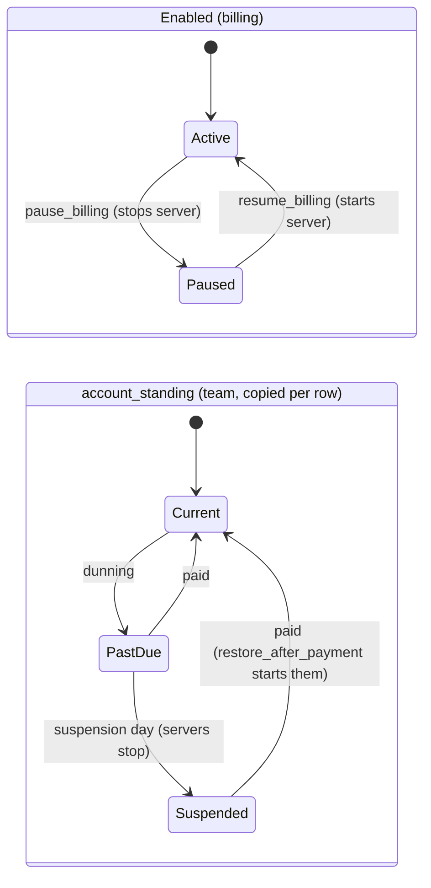
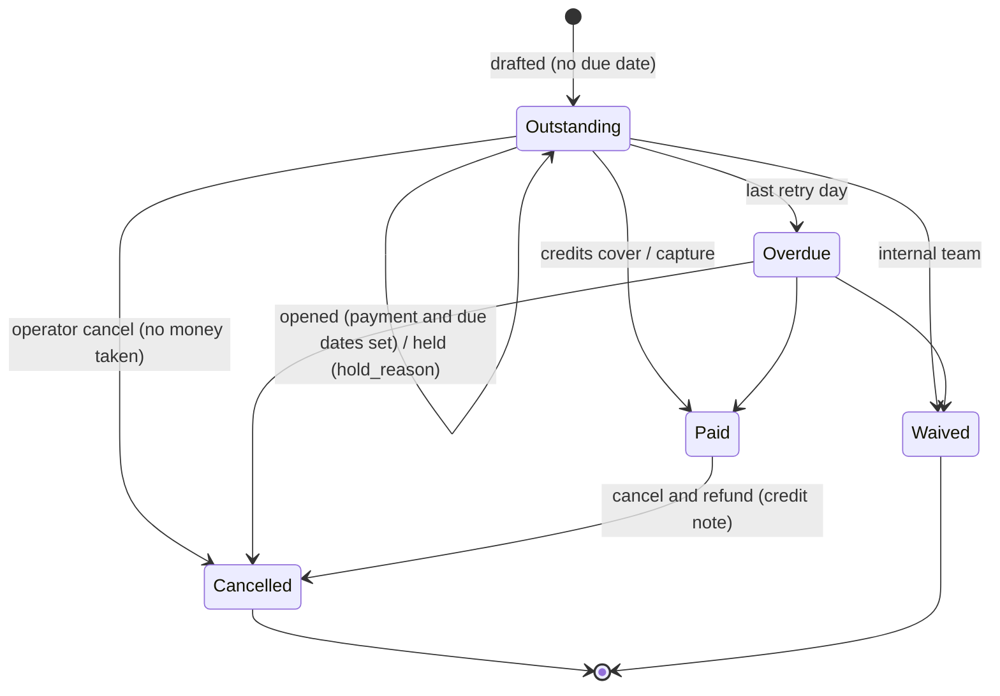
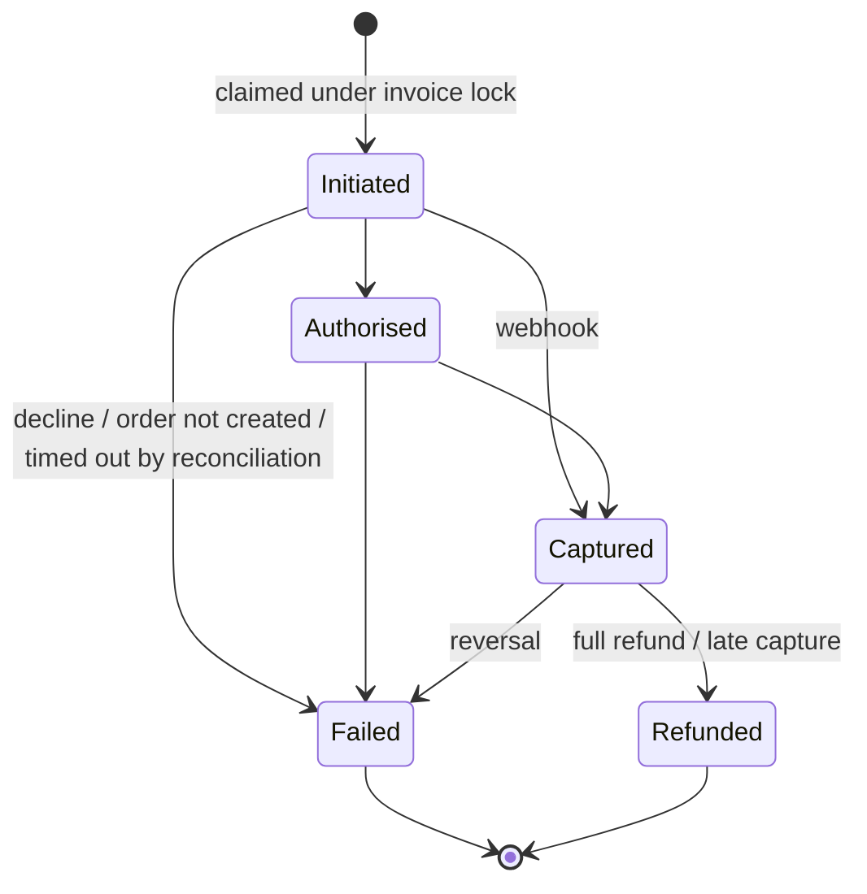
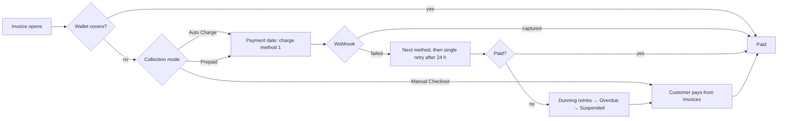
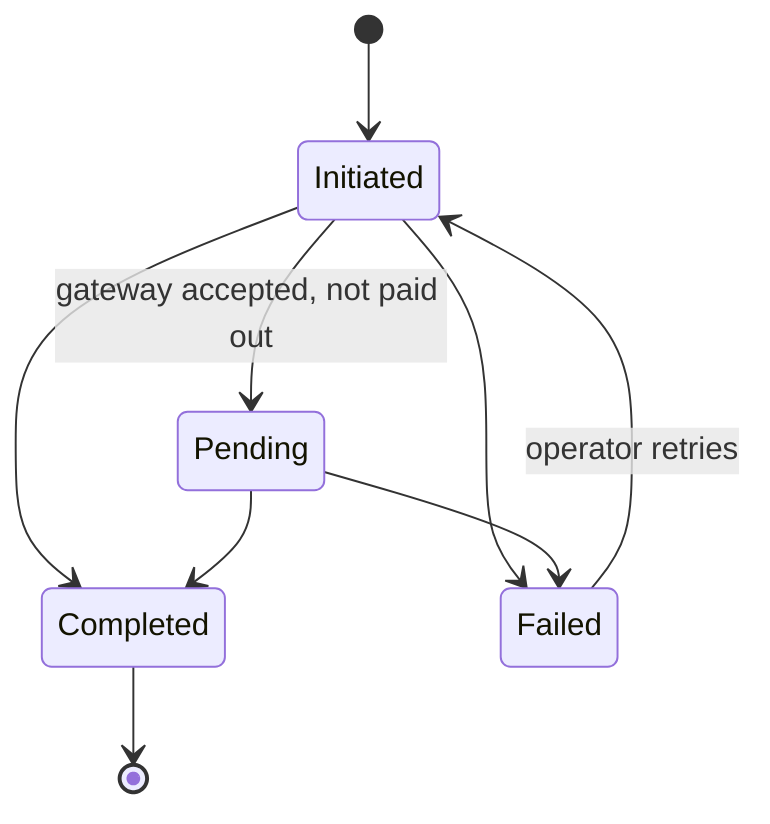
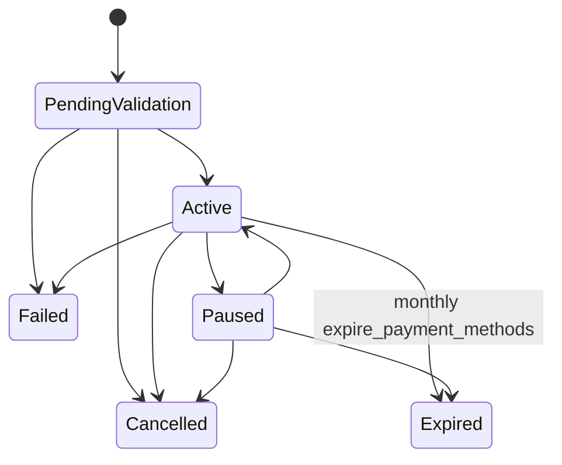
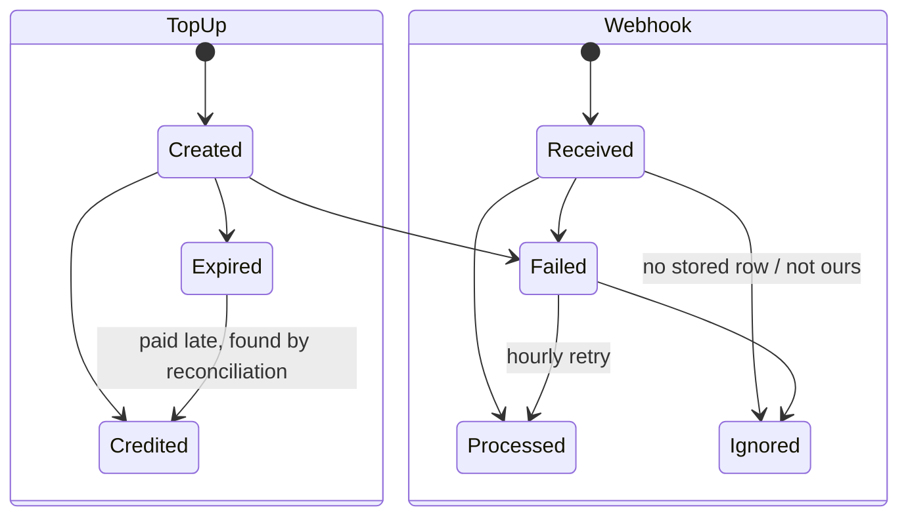
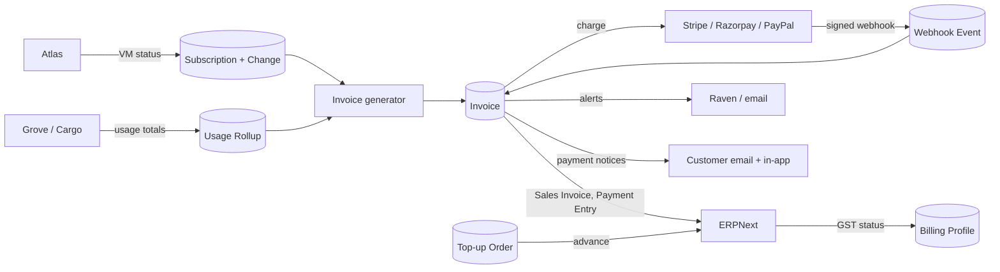

# Lifecycle diagrams

State machines are copied from `central/billing/states.py:39-158` at `a95b491e`. Every
status change goes through `states.transition()`, which refuses a move the machine
does not list and writes a `Billing Event`.

## Subscription

A Subscription has no lifecycle status field. Its life is three separate things:
`enabled` (pause/resume), `account_standing` (dunning), and the server's own status
read from Atlas.

`Subscription Change` records each step as `change_type`: Created, Plan Changed,
Payment Method Changed, Paused, Resumed, Past Due, Suspended, Reactivated, Cancelled.

## Invoice

"Outstanding" covers three customer situations: drafted and not issued, held for
billing details, and issued and owed. The console separates them with `is_issued`
(`dashboard/src/components/billing/OutstandingAlert.vue:28-29`), but the badge on the
invoice list says "Outstanding" for all three.

## Payment Attempt

A partial refund leaves the attempt Captured. Only a full or late-capture refund
moves it to Refunded.

## Payment (end to end, customer view)

Prepaid is drawn into the same charge path as Auto Charge on purpose: the backend
debits a Prepaid team's saved method once credit runs out
(`central/billing/payments/collection_mode.py:105-112` `is_debit_allowed`; dunning
retries Prepaid too, `revenue/dunning.py:331-334`). Only Manual Checkout and Action
Required hold the debit back. The console describes Prepaid differently (F-23).

## Refund

## Payment Method

Failed, Cancelled and Expired are terminal: a card the network renews cannot come
back to Active (issue 129).

## Top-up Order and Webhook Event

## Integration data flow

