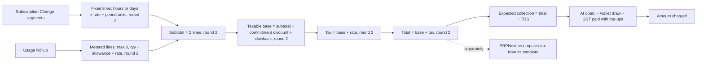

# Financial integrity review

Snapshot `a95b491e`. Static reading only: no invoice was generated and no money
moved. Paths are under `central/billing/`.

## How money is stored

| Aspect | Implementation | Evidence |
|---|---|---|
| Type | Frappe `Currency` (float in Python, DECIMAL in MariaDB), major units. ADR 0003 (integer minor units) was never built and is deprecated. | DocType JSON; `money-integer-minor-units` decision |
| Rounding | `frappe.utils.flt(x, 2)` at each step: per line, subtotal, taxable base, tax, total, expected collection | `revenue/invoicing/lines.py:349,390`; `generate.py:197-208`; `revenue/tax.py:86,91`; `lifecycle.py:95` |
| Rates | Stored at 6 decimal places on rate fields; amounts at 2 | plan-unit model; `lines.py` |
| Currency | One currency per team, fixed after first activity. No FX anywhere in billing. Reports split per currency. | `billing_profile.py:304,433`; `report/_currency.py` |

**Observation (E2).** The line functions take segments and rates and return amounts
with no clock, randomness or external read in between, so the same inputs give the
same lines; every line also carries an `arithmetic` string (`lines.py:405`,
`metering.py:471-473`). This was read in code, not replayed against real invoices.
Two places can produce a different figure for the same invoice: ERPNext's own tax
computation, and per-line rounding before the sum.

## Calculation chain

## Area by area

| Area | Finding | Evidence | Level |
|---|---|---|---|
| Pricing | List price in `Catalog Rate`; the price a customer pays is locked on the `Subscription Change` row. A resize re-prices at today's rate; stop/start keeps the lock. | ADR 0010; `catalog/subscriptions.py` | E2 |
| Proration | Fixed lines prorate by hour or day against the number of days in the billing period (`day_units = _days_in_period`, `hour_units = day_units × 24`). A day costs more in February than in March. First day billed in full; plan changes by the hour (5 Nov 2026 commits). | `lines.py:145-152` | E2 |
| Discounts | Only Commitment (team spend floor). Discount reduces the taxable base; breach adds a clawback line. | `generate.py:199-203`, `catalog/commitments.py` | E2 |
| Tax | GST added at the default rate for Indian teams; SEZ/Overseas zero-rated with a reason; lapsed GSTIN taxed as unregistered; TDS withheld from expected collection. | `revenue/tax.py:55-91` | E2 |
| Tax in ERPNext | ERPNext builds its own GST rows from the Sales Taxes template, so CGST+SGST are rounded by ERPNext, not taken from Central's one 18% figure. | `ingester/erpnext_sync.py:166-168`, `ingester/gst.py:47-56` | E2; size of drift not measured |
| Invoice totals | Sum of rounded lines, then tax on the rounded base. Daily invariant `check_invoice_line_sum`. | `platform/invariants.py:187` | E2 |
| Payment allocation | Short or wrong-currency capture: nothing settled, comment and Error Log. Overpay: invoice Paid, surplus to wallet. Capture on Paid invoice: full refund to source. Capture on Cancelled/Waived: to wallet, operator told. | ARCHITECTURE §4C, `payments/webhooks.py` | E1 (from ARCHITECTURE.md and partial code read); flows not run |
| Partial payments | Not supported as a customer action. A short capture is not applied. | same | E2 |
| Refunds | Full = cancel and refund with ERPNext credit note; partial = refund part, invoice stays Paid; credit note has a deadline. | `payments/corrections.py:45-93,757` | E2 |
| Credit balances | Append-only ledger, wallet row locked `FOR UPDATE` per (team, currency), promotional credit expires soonest-first, purchased credit never expires. | `revenue/credits.py`; `credit_ledger_entry.py:29`; `credit_wallet.py:27-40` | E2 |
| Outstanding balances | Statement gives opening + closing outstanding; the console adds them in two places. | `api/dashboard/reports.py`; `BillingOverviewPage.vue:31-38` | E2 |
| Duplicate charges | Unique `Payment Attempt.idempotency_key`; in-flight attempt blocks a second charge under an invoice lock; Stripe/Razorpay/PayPal idempotency keys; unique `Webhook Event.gateway_event_id`. | `charges.py:292-360`; `gateways/*_adapter.py` | E2 |
| Unbilled usage | One unpriced metered resource **blocks the whole team's invoice** (`frappe.throw`). | `revenue/metering.py:477-482` | E2 |
| Below-minimum months | Written off, no invoice made, event recorded. Not carried to the next month. | `generate.py:333-350` | E2 |
| Financial adjustments | Operator credit/debit (`adjust_team_credits`), rerating of a past period (`api/admin/rerating.py`), rollup term correction. Rerating and rollup correction have no Desk screen. | `api/admin/*` | E1 (no JS caller found by search) |
| Auditability | Every transition writes a `Billing Event`; money DocTypes are read-only in Desk and refuse manual edits even by Administrator; `track_changes` on money DocTypes. | `states.py`; `platform/records.py`; `central/hooks.py:215-230` | E2 |
| Reconciliation | Hourly gateway scan for charged-but-never-webhooked; daily recheck of completed refunds; daily invariant audit with 7 checks. | `payments/reconciliation.py`; `platform/invariants.py:82-382` | E2 |

## Invariant audit coverage

| Check | What it proves | Gap |
|---|---|---|
| `check_wallet_matches_ledger` | Wallet row = ledger sum | — |
| `check_running_balance_chain` | Each entry's running balance follows the previous | — |
| `check_invoice_line_sum` | Lines add up to subtotal | Does not check tax or total |
| `check_paid_invoice_is_covered` | A Paid invoice has money or credit behind it | — |
| `check_one_live_invoice_per_period` | No duplicate live invoice | Unique key already prevents it |
| `check_captured_matches_amount_paid` | Captures equal amount paid | — |
| `check_no_stuck_attempts` | No attempt left Initiated too long | — |
| *(missing)* | Central invoice total = ERPNext Sales Invoice total | See R-01 |
| *(missing)* | Central wallet = ERPNext advance balance | See R-05 |

## Summary

Present in code (E1–E2): append-only ledger, one transition function, unique keys on
every idempotent write, a daily invariant audit, lines that show their arithmetic.
Not confirmed in operation: that the unique indexes exist in the production database,
that the audit runs and what it has found.

Gaps found in code: two tax engines with no comparison, per-line rounding, one
missing rate stopping a whole invoice, money rules copied into the browser. None is
measured yet. Details are in [calculation-risks.md](calculation-risks.md).
