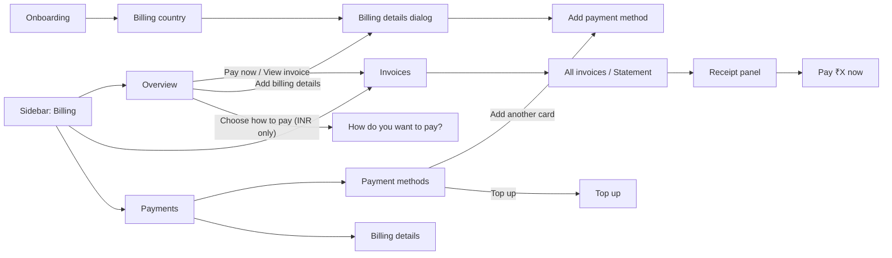

# Navigation audit (D1–D4)

How a person finds the payment-setup and invoice tasks, and where the path breaks.
Source only (see [screen-inventory.md](screen-inventory.md#how-the-screens-were-inspected)).
`CB-nn` points to [problem-register.md](../12-problem-discovery/problem-register.md).

## Customer console

### Information architecture

Three pages under one sidebar entry. Their names match the tasks: *what do I
owe* (Overview), *find or pay an invoice* (Invoices), *how I pay* (Payments).
This top level works.

### Task paths

| Task | Path today | Clicks | Break |
|---|---|---|---|
| Pay an overdue invoice from the Overview | Banner "Pay now" → Invoices list → find the row → panel → "Pay ₹X now" | 4 | The banner knows which invoice is owed (`OutstandingAlert.vue:63-71`) but navigates to the list without it (`:85-92`). The Invoices page already opens a panel from `?invoice=` (`BillingInvoicesPage.vue:73-80`). **CB-08** |
| Change how I pay (Auto Charge / Manual Checkout / Prepaid) | No path. Only the INR "Action required" banner opens a chooser, and it says "You can switch anytime in Billing settings" (`CollectionActionBanner.vue:134-136`). No such screen exists. | — | **CB-03** |
| Change which method is charged first | Payments → row menu → "Primary payment method" (disabled while credits > 0) or "Move up" | 2–3 | Two controls with the same effect, one disabled without a reason. **CB-05** |
| Add UPI Autopay | Payments → "Add another card" → UPI tile | 2 | The entry is labelled "card". **CB-14** |
| Fix billing address | Payments → Billing details "Edit" | 2 | Fine. |
| Find last year's invoices | Invoices → date preset "Last year" | 2 | Fine. Presets match how people search (`InvoiceListView.vue:40-44`). |
| Find a cancelled or waived invoice | Invoices → Status filter | — | The filter offers only Outstanding, Paid, Overdue (`InvoiceListView.vue:92-101`). **CB-16** |
| Get the tax invoice | Invoices → row download, or panel "Download PDF" | 1–2 | Fine, but the Statement tab says "Tax invoices are issued separately" (`StatementCard.vue:49`). **CB-16** |
| Email an invoice to accounts | Panel "Email invoice" | — | Always disabled (`BillingInvoicesPage.vue:195-201`). **CB-15** |

### Discoverability

- **The payment day is hidden in a tray.** It is reached from a calendar icon next to
  "Next payment date" on the Overview (screen-map). It is not on the Payments page,
  where people look for "how I pay". Navigation finding only; a fix belongs with CB-03.
- **The Payments page holds no collection-mode state.** A customer cannot see
  whether they are on Auto Charge, Manual Checkout or Prepaid. The mode is read
  (`PaymentMethodsCard.vue:105-112`) but used only to change labels.
- **The setup banner is consistent.** It appears on the Payments page
  (`BillingPaymentsPage.vue:35-49`) and starts the same details → method chain as
  onboarding (`PaymentMethodFlow.vue:14-21`). A reader without manage rights gets
  "Ask a team admin" instead of a dead button.

### D3 and D4 paths (checkpoint 2)

| Task | Path today | Break | ID |
|---|---|---|---|
| See what this month costs | Overview → This cycle headline | Five figures for one idea across the page | CB-26 |
| Understand the spend limit | Overview → tier link or Limits card → Limit tiers tray | Three figures; the gate's figure is nowhere | CB-25 |
| Set a budget alert | Overview → bell "Budget alerts" | Saved, never sent | CB-23 |
| Top up | Overview facts "Add credit"; Wallet history footer; Payments "Top up" | Three entries, one dialog: fine | — |
| See wallet history | Overview → small history icon beside "Wallet" (seen) | Only from the Overview; not on Payments, where credits are listed | — (fold into CB-29 fix) |
| See when credit expires | Overview facts hint only | Not in wallet history | CB-31 |

## Operator (Desk)

### Information architecture

The Billing sidebar (`central/workspace_sidebar/billing.json`) has 95 items in
13 sections: Catalog, Customers, Subscriptions, Revenue, Operations, Dashboards,
Revenue Reports, Profitability, Capacity, Collections, Credits and Growth,
Billing Health, Setup.

- **The sections follow the data model, not tasks.** A support agent who gets
  "my card was charged twice" has to know that the answer spans Invoice, Payment
  Attempt, Webhook Event, Credit Ledger Entry and Refund, and open each list,
  filtered by team, one at a time.
- **No team-centred entry.** `central.billing.api.admin.teams.get_team_billing`
  returns subscriptions, invoices and payment attempts for one team
  (`central/billing/api/admin/teams.py:33-60`). Nothing calls it: the only references
  are its export in `api/admin/__init__.py:55,79` and `ARCHITECTURE.md:702`. The
  Team form has no billing connections, because there is no `team_dashboard.py`
  in `central/identity/doctype/team/`. **CB-18**
- **A retired DocType is in the menu.** "Entitlement Token" sits under
  Subscriptions (`billing.json:257-258`). Phase 1 found no caller of `issue_token`
  outside tests and demo (P1-12).
- **Impersonation is the support shortcut.** The Team form offers "Impersonate Team
  Owner" (`team.js:40`), so support can see the customer's console. That works for
  looking but runs as the customer, which is the wrong tool for an operator action.

### Task paths (operator)

| Task | Path today | Break |
|---|---|---|
| See one customer's billing state | Open Billing Profile, Payment Method, Invoice and Payment Attempt lists separately, each filtered by team; or impersonate | **CB-18** |
| Cancel an unpaid invoice | Invoice form → "Cancel" → reason prompt (`invoice.js:8-11,44-61`) | Reason only; no summary of effects. **CB-19** |
| Refund part of a paid invoice | Invoice form → "Refund Part" → amount, destination, reason (`invoice.js:63-107`) | Works. The amount field states what is left and the card cap. |
| Retry a failed charge, or send a payment link | No Desk action on Invoice (`invoice.js` has none) | **CB-19** |
| Give goodwill credit | Team form → "Adjust Credit" (`team.js:39,169-237`) | Works. Shows the team currency; refuses when there is none (`team.js:191-194`). |
