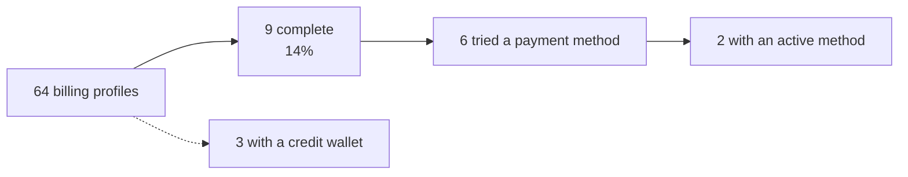

# Measurements (production backup)

Read-only `SELECT` queries on `prod-central-bck.local`, the production backup
served by the local bench (`pause_scheduler` and `mute_emails` are set in its site
config). The latest Invoice change in the backup is **3 Nov 2026 12:39**, so these
are production facts as of that moment: evidence level **E4 (data)**. Nothing was
written. Only counts and amounts are reported; no team, person or record id.

The query files are in the session scratchpad (`m1.sql`–`m3.sql`), not in this repo.

## Who is billed

| Measure | Value |
|---|---|
| Billing profiles | 143 (79 internal, **64 external**) |
| External profiles by collection mode | **Prepaid: 64** (52 INR, 12 USD). Auto Charge, Manual Checkout, Action Required: 0 |
| Country vs currency (all profiles) | India/INR 130, other/USD 13. No mismatches |

## D1 Billing setup and payment methods

External teams only.

| Measure | Value | Bears on |
|---|---|---|
| Profiles with legal name, address line 1, city and country | 9 of 64 | CB-12, D-08 |
| Incomplete profiles (no legal name) | 55, of which **43 have country = India and nothing else required** | CB-12 |
| Payment methods, all teams, by status | Card: 3 Active, 1 Failed, **8 Pending Validation**. UPI Autopay: 1 Active, **5 Pending Validation** | CB-21 |
| Age of Pending Validation methods at backup time | 6 to 20 days; none had become Active | CB-21 |
| Teams whose only methods are Pending Validation | **10** | CB-21 |
| Pending card setups by reference prefix | 5 Stripe Checkout Session (`cs_li…`), 1 test session (`cs_te…`), 2 SetupIntent (`seti_…`) | CB-21 |
| Webhook events matched to a Pending Validation method | UPI: 4 × Razorpay `payment.failed`, all **Ignored**. Card: 1 × `setup_intent.created`, Processed | CB-21 |
| Billing Events "Payment Method Active" | 5 ever | CB-21 |
| Prepaid teams that also hold an active card or UPI method | **4** | CB-04 |
| External teams with a positive wallet balance and an active method | 1 | CB-05 |

**What this does and does not show.** Most teams that start adding a method do not
finish, and the unfinished rows never resolve. `list_payment_methods` hides
Pending Validation rows (`central/billing/api/dashboard/methods.py:34`), so the
customer sees nothing either. Whether the customer abandoned, the bank declined,
or a confirmation was lost is **not established**. The 4 ignored UPI
`payment.failed` events show that at least some were bank failures that left the
row Pending instead of Failed.

## D2 Invoices and collection

| Measure | Value | Bears on |
|---|---|---|
| Billable invoices | 17: **Waived 11** (all internal teams), **Cancelled 4**, **Outstanding 2**, Paid 0 |
| External billable invoices | 6: 4 Cancelled, 2 Outstanding | CB-16 |
| Statuses the customer list can filter | Outstanding, Paid, Overdue. **4 of 6** external invoices are in a status it cannot filter | CB-16 |
| Cancelled external invoices, totals | ₹0.01, ₹0.26, ₹14.04, ₹42.74 | CB-16, D-07 |
| Outstanding external invoices | 2 (₹11,367.17 and ₹2,200.80). **Both** have `hold_reason = Accounting Sync`, no ERPNext invoice, `erpnext_sync_status = Pending` | CB-22 |
| Payment Attempts | **0** | CB-07, CB-09, CB-10 |
| Invoices with credits, top-up GST or TDS applied | 0 of 17 | CB-01 |
| Invoices where `total ≠ expected_collection` | 11, all Waived (expected 0) | CB-01 |
| Webhook events | 46 total: 4 Processed, 42 Ignored | CB-21 |

**What this does and does not show.** At backup time no external customer could
pay an invoice from the console. Both owed invoices were held for accounting
sync, which shows "This invoice is being prepared" (`BillingInvoicesPage.vue:389-393`).
Whether the hold comes from production configuration or was cleared after 3 Nov
is **not established**. Settle that before acting on CB-22. No customer has used
Pay now yet, so the pay-flow problems (CB-07, CB-09, CB-10) have **no measured
frequency**. Their priority comes from how many teams they will reach, not from
incidents.

## D3 Cost visibility and limits (checkpoint 2)

External teams, same backup.

| Measure | Value | Bears on |
|---|---|---|
| Trust tier | Beginner 61, Intermediate 2, none 1 | CB-25 |
| Beginner limit per cycle | ₹8,300 / $100 / €92 | CB-25, CB-32 |
| Tier ladder (USD) | Beginner 100 → Growth 250 → Intermediate 1,000 → Advance 2,500 → Power 7,500 → Elite 10,000 | — |
| Manual tier override | 2 teams | CB-25 |
| Budget alert set | **0 of 64** | CB-23 |
| Payment day | All 64 on day 1 (the default) | — |
| Teams with any subscription | 6 | — |

## D4 Wallet and credits (checkpoint 2)

All teams unless stated.

| Measure | Value | Bears on |
|---|---|---|
| Credit wallets | 33, of which 30 have a positive balance (₹185,525 total); 3 belong to external teams | — |
| Credit ledger entries | 32 promotional credits (all with an expiry; 27 "Welcome credits"), 1 top-up credit; **0 debits** | CB-31 |
| Top-up Orders | 1, status Created (₹25,000), never completed | CB-21 |
| Ledger notes visible to customers | include a gateway payment id and operator wording | CB-29 |

**What this shows.** Credit has been granted but never spent: no invoice has been
paid and no debit has been booked. The limit, alert and wallet screens have mostly
shown zeros so far. Their problems come from code and the demo, and will reach
every team once billing runs.

## D5 Subscriptions and projects (checkpoint 3)

| Measure | Value | Used in |
|---|---|---|
| Enabled subscriptions | 81; 14 belong to external teams (7 servers, 7 services) | CB-41 |
| External servers | 20 running, 10 stopped; 13 running and all 10 stopped are free trials with no subscription (expected) | CB-35 |
| Subscription Change rows | 228 Created, 55 Plan Changed, 147 Cancelled, 1 Paused, 0 Resumed | CB-34 |
| The paused subscription | Internal team, ₹710/month, paused 24 Oct; invoiced 13 whole days 19 Oct–1 Nov (₹297.74), waived | CB-34 |
| Projects | 2, 1 enabled, 0 with a spending limit, 1 tagged subscription | CB-36 |

## D6 Purchase-time billing (checkpoint 3)

| Measure | Value | Used in |
|---|---|---|
| Paid server creates (Oct–3 Nov) | 239; 81 failed: 80 internal `ATLAS_REJECTED`, then mailbox pool (5), Atlas (2), capacity (1), others | CB-40 (infrastructure, not billing) |
| Billing refusals recorded | 0 (they never become actions; Error Log has none) | CB-40 |
| External teams with credit and no active method | 2 | CB-39 |
| `require_payment_method` | on | CB-39 |
| `grant_welcome_credits` | off | CB-39 |

## D7 Operator back office (checkpoint 3)

| Measure | Value | Used in |
|---|---|---|
| Number card "Active Subscriptions" | 81 shown, 14 external | CB-41 |
| Entitlement Token rows | 0 (still in the sidebar) | CB-41 |
| Raven fields, alert emails | Empty in the backup; settings row modified by the local migrate (6 Nov) | H-05 |
| Error Log | 1,623 rows, 1–15 Oct; 0 "Billing operator alert" rows | H-05 |

## Open-points pass (9 Nov 2026)

| Measure | Value | Used in |
|---|---|---|
| Stripe setup webhooks | 7 created, 8 requires_action, 3 succeeded, 1 setup_failed | CB-21 |
| Payment Gateway webhook registration | Stripe and Razorpay: no endpoint recorded, `is_webhook_active = 0`; events still arrive | CB-21 |
| Revenue base in revenue reports | ₹69,719.75 over 13 invoices; ₹56,151.78 (11) waived internal | CB-44 |
| Promotional grants | 32, all expiring, no notice sent | CB-45 |

## D8 Metered services

| Measure | Value | Used in |
|---|---|---|
| Team Services | AI: 8 active (1 external since 30 Oct, 7 internal since 8 Oct), 0 with a subscription. Storage: 6 active, all internal, all with a subscription | CB-46, CB-47 |
| Usage Rollups | 4, all Storage, all internal, 2.05 GB-months total, locked rate 0, allowance 0 | CB-47, CB-48 |
| AI usage rows in Central | 0 | CB-46 |
| AI trial keys | 51 since 29 Oct | CB-46 |
| Metered categories | AI Tokens, Emails, PDF Generation: Authoritative, Postpaid Overage, no plan. Remote Storage: Incremental, one plan, 0 GB included | CB-46, CB-47 |
| Grove retention | Usage Records purged after 90 days (`usage_record.py:13`) | CB-46 |

## How the measurements changed priorities

| Problem | Before measuring | After | Why |
|---|---|---|---|
| CB-21 setup never completes | not known | **P1** | 10 teams stuck; it blocks the welcome credit and servers |
| CB-22 owed invoices unpayable | not known | **P1, confirm first** | 2 of 2 external owed invoices |
| CB-03 / CB-04 collection mode | P1 | P1 | Every external team is Prepaid; 4 also hold a method the backend can debit |
| CB-01 receipt arithmetic | P1 | **P2** | No invoice has credits or TDS yet |
| CB-02 last method removal | P1 | **P2** | No team is on Auto Charge |
| CB-16 status filter | P3 | **P2** | Most external invoices are Cancelled |
| CB-12 country auto-save | P2 | P2 | 43 profile rows fit the pattern; cause not proven |
| CB-25 limit figures | P2 (F-01) | **P1** | 61 of 64 teams on a $100 / ₹8,300 limit, so the gate will refuse often |
| CB-23 budget alert | — | P2 | Never sent, but 0 teams have set one |
| CB-04 Prepaid | P1 | **P2** | Decision: the engine is right; copy only |
| CB-22 held invoices | P1 | **Deferred** | Decision: expected until the integration is finalised |
| CB-34 pause keeps charging | — | **P1** | Shown on real data (one paused server billed after its pause); a wrong charge |
| CB-36 project limit | — | P3 | No project has a limit |
| CB-35 stop billing | — | P2 | No external exposure today; docs contradict the engine |
